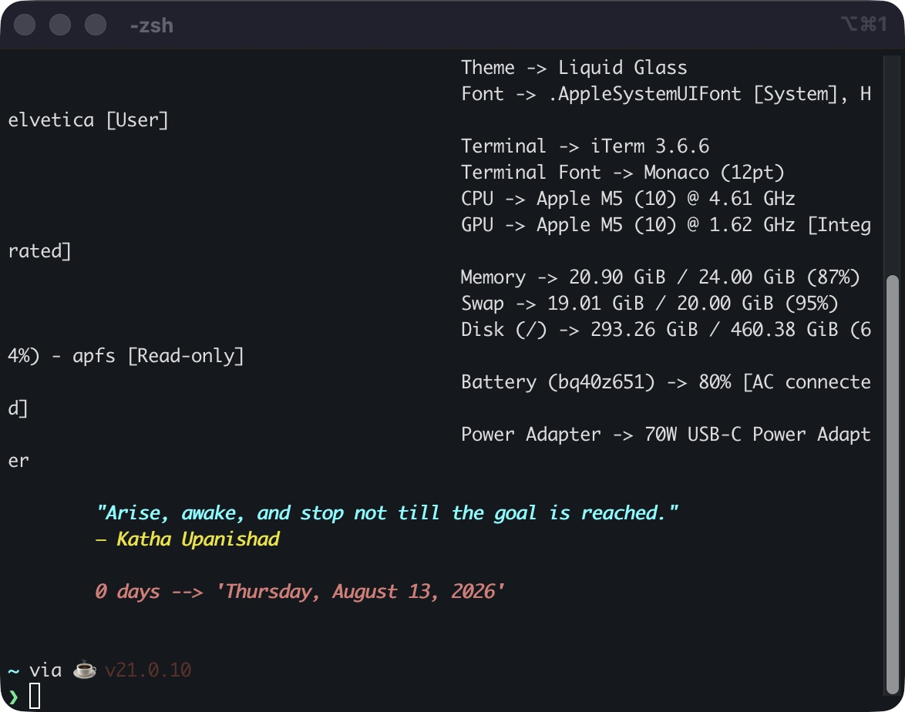
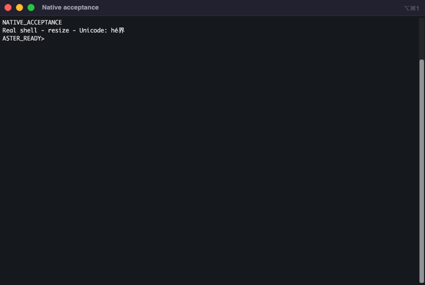
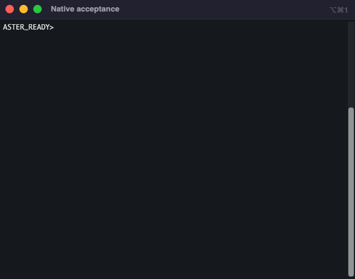
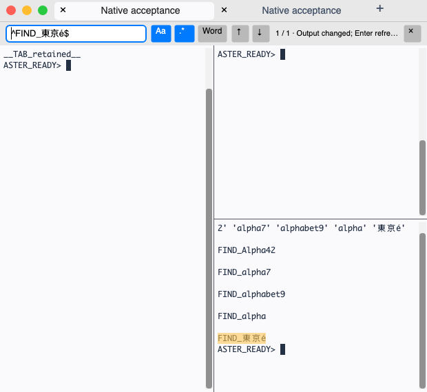
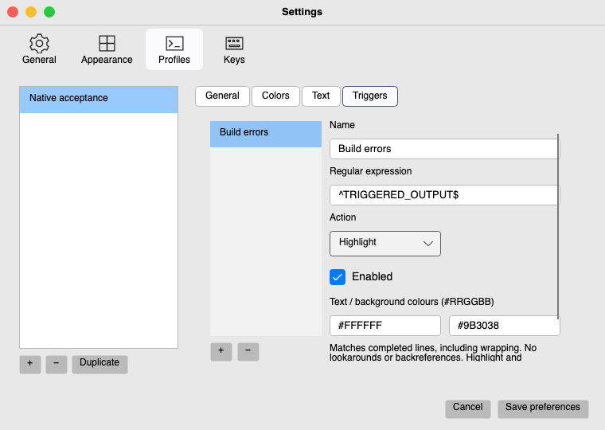
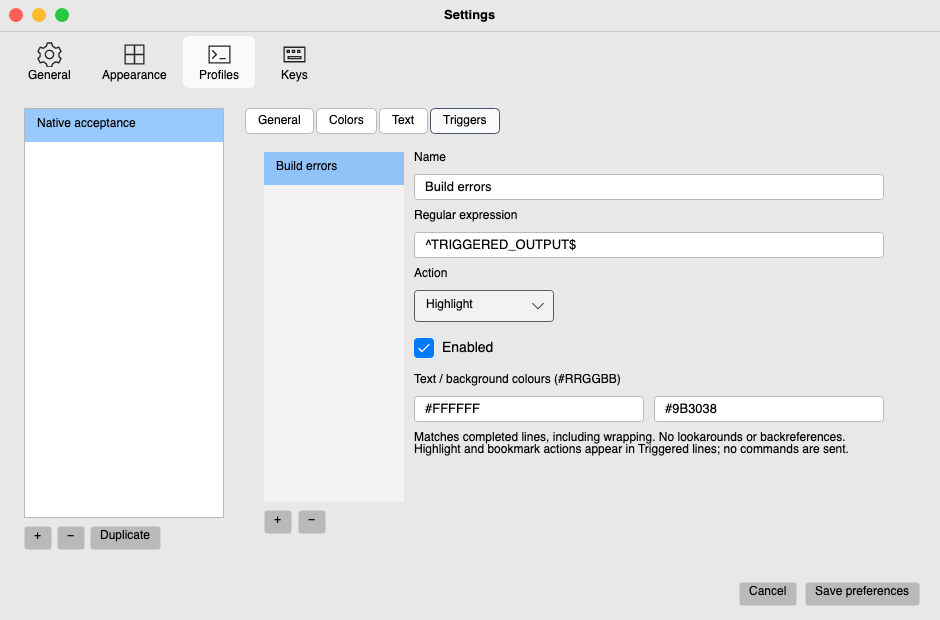
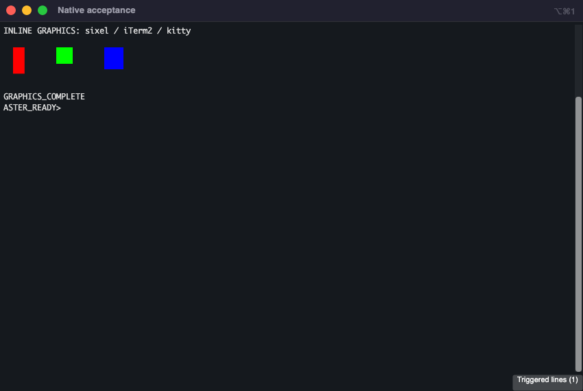
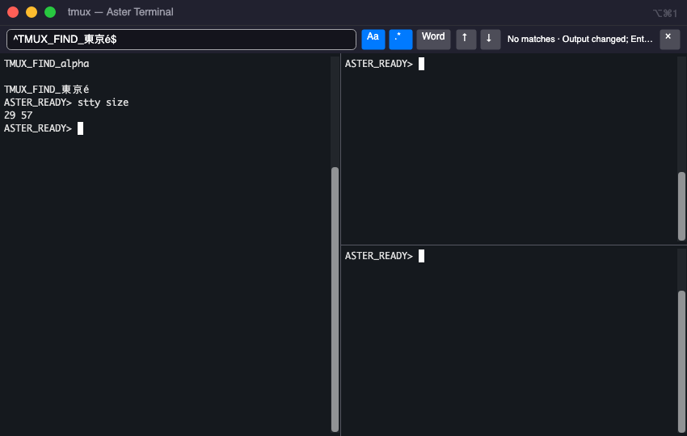
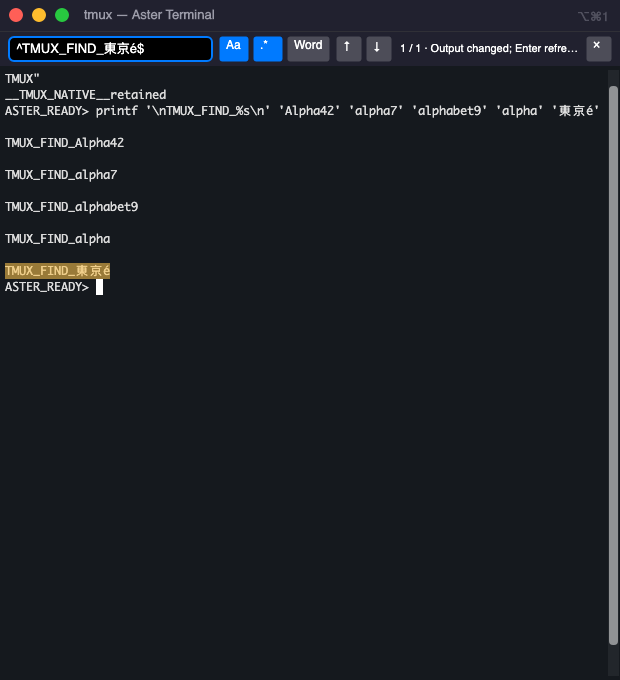

# Aster Terminal

A real C#/Avalonia terminal bringing a documented subset of **iTerm2** workflows
to macOS, Windows and Linux. Independent project; no iTerm2 endorsement.
GPL-3.0-or-later. **Version 0.12.0 is the competition release; full iTerm2 parity
is a separate milestone.**

[Download v0.12.0](https://github.com/kris70lesgo/aster-terminal/releases/tag/v0.12.0)
· [Runtime evidence](docs/test-matrix.md) · [Feature boundaries](docs/iterm2-feature-parity.md)

Version 0.12.0 follows the installed **iTerm2 3.7.4** reference: a clean
single-tab caption with working window-number hint, native scrollback scrollbar,
reference dark/ANSI colours, and corrected font sizing. Existing nominal font
values now render at 3/4 of earlier builds, fixing the point-unit mismatch.
Preferences → Profiles → Text → **Use iTerm reference appearance** selects
Monaco 12 on Mac or bundled Cascadia Mono 12 elsewhere; Save/Cancel stays
transactional. [Visual evidence and remaining differences](docs/visual-parity.md)
distinguish this from complete pixel/UI parity.

Enable the optional summon window in Preferences → General with
**Ctrl+Alt+Space** (Control+Option+Space on macOS). The chord shows a dedicated
terminal; pressing it while active hides it while its shell keeps running.
Global summon/hide/show passes on macOS, Windows and Linux X11 in native CI.
Wayland is unsupported; key conflicts are reported. A physical attempt on the
local macOS 26 workstation was not detected and remains unverified.

The optional Python API now works with the original **iterm2 2.30** client for
real window/tab/pane creation, command input, Unicode screen reads, layout/focus
notifications and session close. Enable it in Preferences → General, then use the
bundled `Scripting/aster_script.py` launcher. It is disabled by default and grants
trusted scripts terminal control. See [setup and supported APIs](docs/scripting.md).
Version 0.8.1 fixes the reproduced Mac exit stall and stops scripting transport
without waiting for an unfinished UI action. Fresh installed-package checks now
require PID exit and a clean native main-loop return; earlier failures remain in
the [runtime evidence](docs/test-matrix.md).

## Install

Packages include the .NET runtime. Extract the complete archive, preserving its
folders; no SDK, account or subscription is required.

| Download | Run | Platform scope |
|---|---|---|
| `aster-terminal-0.12.0-osx-arm64.zip` | Move **Aster Terminal.app** to Applications; launch it | Apple Silicon, macOS 15+; native checks on macOS 15 and 26, including installed 2× Retina |
| `aster-terminal-0.12.0-win-x64.zip` | Run **Aster.Terminal.exe** from the extracted folder | Windows x64 with ConPTY; tested on hosted Windows Server 2025. Windows 11 is the intended desktop target |
| `aster-terminal-0.12.0-linux-x64.tar.gz` | Run **./Aster.Terminal** inside the extracted directory | Ubuntu 24.04 x64, X11/Xvfb verified; other distributions and native Wayland remain unverified |

Extract the Mac ZIP with Finder/Archive Utility (or `ditto`) to preserve signing
metadata. macOS is ad-hoc signed, without Developer ID notarization. For a downloaded copy,
use the macOS **Privacy & Security → Open Anyway** flow if Gatekeeper blocks it.
Windows is unsigned and may display SmartScreen; inspect the source and verify
the supplied SHA-256 before choosing to run it. No system security setting needs
to be disabled.

Linux needs desktop/font libraries: `libfontconfig1 libx11-6 libice6 libsm6
libxrender1 libxi6 libxrandr2 libxcursor1 libegl1 libgl1` on Ubuntu, in addition
to .NET's system requirements. Install `fonts-noto-cjk` for CJK glyph fallback;
fonts unavailable on the host appear as missing glyphs. The portable desktop entry expects
`Aster.Terminal` on PATH; set its Exec to the extracted binary's absolute path
when installing it in your desktop menu. The native PTY helper is already included.

## Use

Each pane starts an independent local shell: `$SHELL` on Unix, PowerShell on
Windows. Shell → New tab with profile selects another installed shell, including
Command Prompt. Preferences configures profiles, command/cwd/environment, fonts,
colours, cursor, history, theme, close confirmation and shortcuts. Settings save
atomically with backup recovery. Saved layouts start fresh shells. With live
recovery enabled (the default), separate local hosts keep actual shell processes
alive across UI loss; startup reconnects detached sessions. Shell → Detach and
close window preserves them intentionally. Normal pane/window close terminates
them. Settings → General can disable hosting for new panes. Host/OS termination
is not survived; an 8 MiB in-memory journal has explicit text-checkpoint limits.

| Action | macOS | Windows/Linux |
|---|---|---|
| New tab / window | Cmd+T / Cmd+N | Ctrl+Shift+T / Ctrl+Shift+N |
| Split right / below | Cmd+D / Cmd+Shift+D | Ctrl+Shift+D / Ctrl+Shift+Alt+D |
| Close pane | Cmd+W | Ctrl+Shift+W |
| Find | Cmd+F | Ctrl+Shift+F |
| Copy / paste | Cmd+C / Cmd+V | Ctrl+Shift+C / Ctrl+Shift+V |
| Next / previous tab | Ctrl+Tab / Ctrl+Shift+Tab | Ctrl+Tab / Ctrl+Shift+Tab |
| Move tab left / right | Ctrl+Shift+PageUp / Ctrl+Shift+PageDown | Ctrl+Shift+PageUp / Ctrl+Shift+PageDown |
| Next / previous pane | Cmd+] / Cmd+[ | Ctrl+Shift+] / Ctrl+Shift+[ |
| Zoom pane | Cmd+Enter | Ctrl+Shift+Enter |
| Screen replay | Cmd+Alt+B | Ctrl+Shift+Alt+B |
| Preferences | Cmd+, | Ctrl+Shift+, |
| Larger / smaller font | Cmd+Shift+= / Cmd+minus | Ctrl+Shift+= / Ctrl+Shift+minus |
| Previous / next command mark | Cmd+Up / Cmd+Down | Ctrl+Shift+Up / Ctrl+Shift+Down |
| Interrupt a foreground process | Ctrl+C | Ctrl+C |

Drag normal terminal tabs to reorder them, using the insertion marker, or use
Session → Move tab left/right. Keyboard moves wrap at the ends. The same live
shells, splits, zoom, Find focus and scripting identities survive the move;
saved layouts retain the order. Escape or releasing outside a tab header cancels
a drag. Groups/pinning, moves between windows, pane dragging and tmux server
window ordering remain separate parity gaps.

The UI keeps the terminal in focus: no permanent toolbar or pane footer, an
automatically hidden single-tab strip, thin split dividers and native macOS
menus. Settings divides profile editing into General, Text, Colours and Triggers. General
can enable the optional status bar or always-visible tab strip. Existing profiles
keep their chosen fonts; fresh macOS profiles use Monaco 12.

Profiles can highlight matching output or bookmark completed lines. Configure
Settings → Profiles → Triggers; **Triggered lines** appears in a pane after a
match and navigates back to its retained scrollback. Rules never execute host
actions. See [output rules](docs/output-rules.md) for examples and bounds.
Incoming output preserves a scrolled view until those lines leave history.

Inline graphics acceptance covers sixel, iTerm2 OSC1337 PNG and direct-data kitty
RGBA, including actual rendered pixels from real shell output on each target.
Other image variants/animation and graphics in replay remain unverified.

Screen replay stores a bounded history of visible text screens in memory. Open
Session → Instant replay, then seek with the slider or arrow keys; Escape closes
it. Shells keep running. Recording stops and history clears when disabled in
Settings → General or when a pane closes. Text, Unicode, colours, grid dimensions
and cursor position/visibility are covered; images and binary iTerm2 DVR files
are not. See the [architecture](docs/architecture.md) for capture and budget limits.

On macOS/Linux with tmux installed, create a session (for example,
`tmux new-session -d -s work`), then choose Shell → Attach tmux session and enter
`work`. Its windows and panes appear as native controls. The tmux menu creates
windows/splits, closes panes, finds text and detaches; common tab/split/copy/paste/
find/close shortcuts work. Closing the control window detaches while tmux keeps
the shells. This is explicit local `-C` control attach; automatic in-shell `-CC`,
SSH/WSL attach and complete historical VT/graphics hydration remain unfinished.

Normal and native tmux panes share the compact Find bar in 0.9.0. Tmux Find
searches output retained in Aster since attach, including the initial viewport;
it does not import the tmux server’s entire earlier history. Pane/tab changes
rebind it, and detach cancels pending work while preserving server shells.

Find offers regex, case and whole-word controls, result counts and wrapping
Enter/Shift+Enter navigation. Escape closes the compact bar. Background searches
use logical Unicode anchors across soft wraps; Enter refreshes changed output.
Invalid patterns and bounded partial results are explicit. See [Find](docs/find.md)
for limits; the tmux control window retains its literal prompt.

Enable command marks in a bash or zsh
profile to load the bundled original shell integration; user startup files are
preserved and never edited. OSC title/cwd/host/status metadata is display-only.
VT clipboard writes and notifications are disabled. Multiline paste prompts
before sending text to the shell. No telemetry, cloud sync or AI services are added.

## Build and verify

Install SDK **10.0.402**; macOS requires Command Line Tools/cc and Linux requires
cc/libutil development headers. Mac builds also compile the small AppKit exit
bridge with clang against system frameworks. Unix compatibility tests also require vim, less,
tmux and zsh. Dependencies and upstream sources are pinned.

```sh
dotnet restore Aster.slnx --locked-mode
dotnet build Aster.slnx -c Release --no-restore
dotnet test Aster.slnx -c Release --no-build
dotnet run --project src/App
python3 scripts/package.py --rid osx-arm64 --smoke
```

Use the native target RID (`win-x64`, `linux-x64`, `osx-arm64`) for packaging on
its OS. `--smoke` executes the **final self-contained binary** with a real desktop
backend and shell, checks input/resize/layout/cleanup, and captures actual native
renders. Linux CI runs this under Xvfb. The engine benchmark is reproducible with
`Aster.Terminal --benchmark benchmark.json`; native startup/memory/grid resize
measurements are in the smoke report. On this workstation the SDK is in
`.research/dotnet`; set `DOTNET_ROOT` to that directory for framework-dependent runs.

For an installed Mac archive, native checks can also run through the background
`cua-driver` launcher (test tool required), with an existing Python environment
containing `scripts/python/requirements.txt`:

```sh
python3 scripts/verify_installed_macos.py --report artifacts/mac-check --python .research/api-python/bin/python --repeat-scripting 3
```

The report folder must be fresh. This verifies actual process exits and native
main-loop return; it does not inject physical keys or establish IME coverage.

## Migration write-up

Started from an empty repository on **2026-10-14** for the
[Avalonia Port Challenge](https://avaloniaui.net/blog/avalonia-port-challenge).
iTerm2 source is pinned at `069b6e0dd8f3f0d82fc08ea5d294d28f7c5b986e`.
Its AppKit/Metal/CoreText UI and long-lived forkpty servers require different
boundaries on portable desktops. Aster rewrites the window/session/profile layer
in Avalonia, reuses Devolutions' MIT terminal engine/control, and uses ConPTY on
Windows and a native forkpty relay on Unix. It adapts iTerm2's semantic exit-code
scan and metadata protocols and bundles its actual bash/zsh integration scripts.
This is a behavior migration, not a literal translation of the Metal renderer.

Practical problems included a missing Unix helper in the NuGet package, an
Avalonia Headless/xUnit version mismatch, Linux background jobs retaining the PTY,
font/colour settings that the control did not apply automatically, and renderer
disposal racing a queued draw. Recovery exposed ConPTY terminating a live shell
when frontend detach cancelled an accepted write; host-lifetime input fixed it.
Native tmux required byte-preserving parsing, ordered server-owned grids and
correct pixel padding/divider budgets. Each was reproduced and repaired. The hosted
pipeline runs real-process tests and launches the final package on all three OSes;
it verifies more than compilation. Tests cover UTF-8/VT state, malformed output,
profiles/recovery, clipboard/search, independent panes, full-screen vim/tmux/less,
opt-in shell hooks, titles, resizing and cleanup. Exact results and limitations
are in the [test matrix](docs/test-matrix.md).

No human-hours or AI-credit ledger was maintained; development time and AI cost
are **unmeasured**, rather than estimated. Tools used were Codex, .NET, Avalonia,
GitHub Actions and local terminal tools. [Performance evidence](docs/performance.md)
is measured on a defined workload and makes no superiority claim.











Original screenshot © George Nachman/contributors; installed iTerm2 3.6.6 is a
different version and geometry from the source audit. Captures show actual
applications. [Screenshot provenance](docs/evidence/README.md) distinguishes
historical startup references from final native acceptance captures.

Automatic in-shell tmux `-CC`, remote control attach, complete iTerm2 DVR compatibility,
full trigger action/plist compatibility, complete Python API compatibility, customizable hotkeys/Wayland support and complete graphics
parity remain **Milestone B**, with individual statuses in the parity matrix.
Physical IME/AltGr, native clipboard gestures, multi-monitor/DPI and live SSH
coverage are still manual test gaps. A running dependency feature is not credited
as verified Aster behavior without acceptance evidence.

See [migration report](docs/migration-report.md), [architecture](docs/architecture.md),
[migration log](docs/migration-log.md), [licensing](docs/licensing.md),
[dependency sources](docs/dependency-source-map.md), and
[challenge checklist](docs/challenge-compliance.md). The app and evidence are
released; no contest form submission or judging outcome is claimed.
