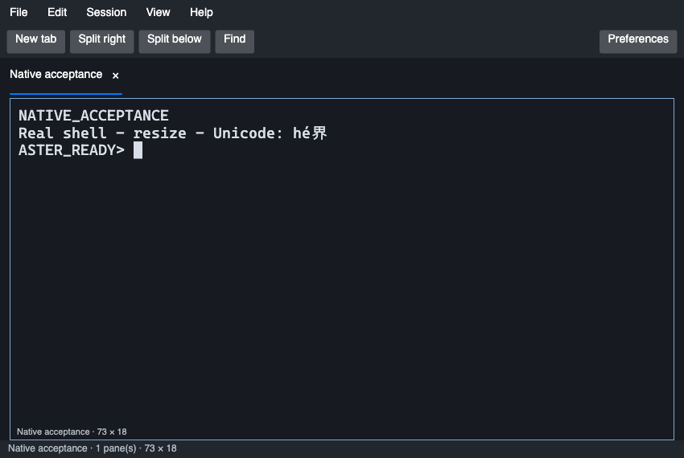
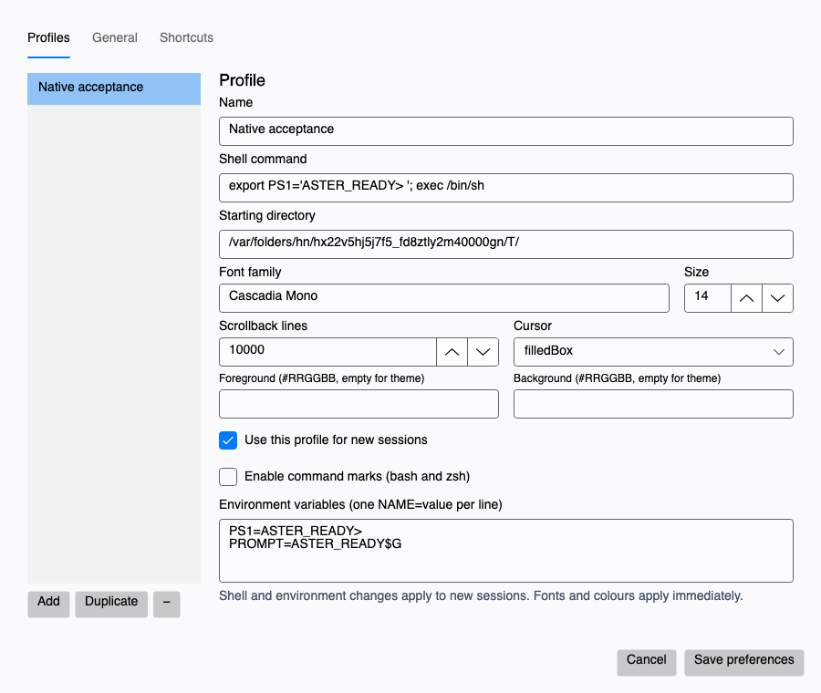

# Aster Terminal

A real C#/Avalonia terminal bringing a documented subset of **iTerm2** workflows
to macOS, Windows and Linux. Independent project; no iTerm2 endorsement.
GPL-3.0-or-later. **Version 0.3.0 is the competition release; full iTerm2 parity
is a separate milestone.**

[Download v0.3.0](https://github.com/kris70lesgo/aster-terminal/releases/tag/v0.3.0)
· [Runtime evidence](docs/test-matrix.md) · [Feature boundaries](docs/iterm2-feature-parity.md)

## Install

Packages include the .NET runtime. Extract the complete archive, preserving its
folders; no SDK, account or subscription is required.

| Download | Run | Platform scope |
|---|---|---|
| `aster-terminal-0.3.0-osx-arm64.zip` | Move **Aster Terminal.app** to Applications; launch it | Apple Silicon, macOS 15+; native checks on macOS 15 and 26 |
| `aster-terminal-0.3.0-win-x64.zip` | Run **Aster.Terminal.exe** from the extracted folder | Windows x64 with ConPTY; tested on hosted Windows Server 2025. Windows 11 is the intended desktop target |
| `aster-terminal-0.3.0-linux-x64.tar.gz` | Run **./Aster.Terminal** inside the extracted directory | Ubuntu 24.04 x64, X11/Xvfb verified; other distributions and native Wayland remain unverified |

Extract the Mac ZIP with Finder/Archive Utility (or `ditto`) to preserve signing
metadata. macOS is ad-hoc signed, without Developer ID notarization. For a downloaded copy,
use the macOS **Privacy & Security → Open Anyway** flow if Gatekeeper blocks it.
Windows is unsigned and may display SmartScreen; inspect the source and verify
the supplied SHA-256 before choosing to run it. No system security setting needs
to be disabled.

Linux needs desktop/font libraries: `libfontconfig1 libx11-6 libice6 libsm6
libxrender1 libxi6 libxrandr2 libxcursor1 libegl1 libgl1` on Ubuntu, in addition
to .NET's system requirements. Install `fonts-noto-cjk` for CJK glyph fallback;
fonts unavailable on the host appear as missing glyphs. The portable desktop entry expects
`Aster.Terminal` on PATH; set its Exec to the extracted binary's absolute path
when installing it in your desktop menu. The native PTY helper is already included.

## Use

Each pane starts an independent local shell: `$SHELL` on Unix, PowerShell on
Windows. Shell → New tab with profile selects another installed shell, including
Command Prompt. Preferences configures profiles, command/cwd/environment, fonts,
colours, cursor, history, theme, close confirmation and shortcuts. Settings save
atomically with backup recovery. Reopening saved tabs/splits **starts fresh shells**;
processes do not survive quitting the app.

| Action | macOS | Windows/Linux |
|---|---|---|
| New tab / window | Cmd+T / Cmd+N | Ctrl+Shift+T / Ctrl+Shift+N |
| Split right / below | Cmd+D / Cmd+Shift+D | Ctrl+Shift+D / Ctrl+Shift+Alt+D |
| Close pane | Cmd+W | Ctrl+Shift+W |
| Find | Cmd+F | Ctrl+Shift+F |
| Copy / paste | Cmd+C / Cmd+V | Ctrl+Shift+C / Ctrl+Shift+V |
| Next / previous tab | Ctrl+Tab / Ctrl+Shift+Tab | Ctrl+Tab / Ctrl+Shift+Tab |
| Next / previous pane | Cmd+] / Cmd+[ | Ctrl+Shift+] / Ctrl+Shift+[ |
| Zoom pane | Cmd+Enter | Ctrl+Shift+Enter |
| Screen replay | Cmd+Alt+B | Ctrl+Shift+Alt+B |
| Preferences | Cmd+, | Ctrl+Shift+, |
| Larger / smaller font | Cmd+Shift+= / Cmd+minus | Ctrl+Shift+= / Ctrl+Shift+minus |
| Previous / next command mark | Cmd+Up / Cmd+Down | Ctrl+Shift+Up / Ctrl+Shift+Down |
| Interrupt a foreground process | Ctrl+C | Ctrl+C |

The UI keeps the terminal in focus: no permanent toolbar or pane footer, an
automatically hidden single-tab strip, thin split dividers and native macOS
menus. Settings divides profile editing into General, Text and Colours. General
can enable the optional status bar or always-visible tab strip. Existing profiles
keep their chosen fonts; fresh macOS profiles use Monaco 12.

Screen replay stores a bounded history of visible text screens in memory. Open
Session → Instant replay, then seek with the slider or arrow keys; Escape closes
it. Shells keep running. Recording stops and history clears when disabled in
Settings → General or when a pane closes. Text, Unicode, colours, grid dimensions
and cursor position/visibility are covered; images and binary iTerm2 DVR files
are not. See the [architecture](docs/architecture.md) for capture and budget limits.

Find uses Enter/Shift+Enter and Escape. Enable command marks in a bash or zsh
profile to load the bundled original shell integration; user startup files are
preserved and never edited. OSC title/cwd/host/status metadata is display-only.
VT clipboard writes and notifications are disabled. Multiline paste prompts
before sending text to the shell. No telemetry, cloud sync or AI services are added.

## Build and verify

Install SDK **10.0.402**; macOS requires Command Line Tools/cc and Linux requires
cc/libutil development headers. Unix compatibility tests also require vim, less,
tmux and zsh. Dependencies and upstream sources are pinned.

```sh
dotnet restore Aster.slnx --locked-mode
dotnet build Aster.slnx -c Release --no-restore
dotnet test Aster.slnx -c Release --no-build
dotnet run --project src/App
python3 scripts/package.py --rid osx-arm64 --smoke
```

Use the native target RID (`win-x64`, `linux-x64`, `osx-arm64`) for packaging on
its OS. `--smoke` executes the **final self-contained binary** with a real desktop
backend and shell, checks input/resize/layout/cleanup, and captures actual native
renders. Linux CI runs this under Xvfb. The engine benchmark is reproducible with
`Aster.Terminal --benchmark benchmark.json`; native startup/memory/grid resize
measurements are in the smoke report. On this workstation the SDK is in
`.research/dotnet`; set `DOTNET_ROOT` to that directory for framework-dependent runs.

## Migration write-up

Started from an empty repository on **2026-10-14** for the
[Avalonia Port Challenge](https://avaloniaui.net/blog/avalonia-port-challenge).
iTerm2 source is pinned at `069b6e0dd8f3f0d82fc08ea5d294d28f7c5b986e`.
Its AppKit/Metal/CoreText UI and long-lived forkpty servers require different
boundaries on portable desktops. Aster rewrites the window/session/profile layer
in Avalonia, reuses Devolutions' MIT terminal engine/control, and uses ConPTY on
Windows and a native forkpty relay on Unix. It adapts iTerm2's semantic exit-code
scan and metadata protocols and bundles its actual bash/zsh integration scripts.
This is a behavior migration, not a literal translation of the Metal renderer.

Practical problems included a missing Unix helper in the NuGet package, an
Avalonia Headless/xUnit version mismatch, Linux background jobs retaining the PTY,
font/colour settings that the control did not apply automatically, and renderer
disposal racing a queued draw. Each was reproduced and repaired. The hosted
pipeline runs real-process tests and launches the final package on all three OSes;
it verifies more than compilation. Tests cover UTF-8/VT state, malformed output,
profiles/recovery, clipboard/search, independent panes, full-screen vim/tmux/less,
opt-in shell hooks, titles, resizing and cleanup. Exact results and limitations
are in the [test matrix](docs/test-matrix.md).

No human-hours or AI-credit ledger was maintained; development time and AI cost
are **unmeasured**, rather than estimated. Tools used were Codex, .NET, Avalonia,
GitHub Actions and local terminal tools. [Performance evidence](docs/performance.md)
is measured on a defined workload and makes no superiority claim.





Original screenshot © George Nachman/contributors; installed iTerm2 3.6.6 is a
different version and geometry from the source audit. Captures show actual
applications. [Screenshot provenance](docs/evidence/README.md) distinguishes
historical startup references from final native acceptance captures.

Native tmux control mode, live process reconnection, complete iTerm2 DVR compatibility,
triggers, Python API compatibility, global hotkey windows and complete graphics
parity remain **Milestone B**, with individual statuses in the parity matrix.
Physical IME/AltGr, native clipboard gestures, multi-monitor/DPI and live SSH
coverage are still manual test gaps. A running dependency feature is not credited
as verified Aster behavior without acceptance evidence.

See [migration report](docs/migration-report.md), [architecture](docs/architecture.md),
[migration log](docs/migration-log.md), [licensing](docs/licensing.md),
[dependency sources](docs/dependency-source-map.md), and
[challenge checklist](docs/challenge-compliance.md). The app and evidence are
released; no contest form submission or judging outcome is claimed.
