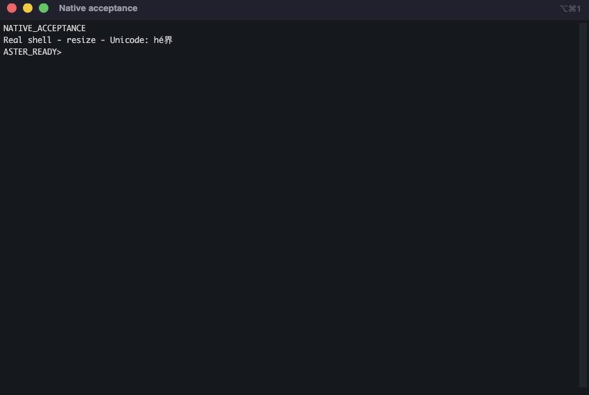

# Aster Terminal

[](https://github.com/kris70lesgo/aster-terminal/releases/latest)
[](https://github.com/kris70lesgo/aster-terminal/actions/workflows/build.yml)
[](LICENSE)

**A native desktop terminal for macOS, Windows, and Linux, built with C# and Avalonia.** Aster ports a documented, tested subset of [iTerm2](https://iterm2.com/) workflows to three desktop platforms while using each platform's real shell process. It is an independent project and is not endorsed by or affiliated with the iTerm2 authors.

[Download Aster 0.14.0](https://github.com/kris70lesgo/aster-terminal/releases/tag/v0.14.0) · [See what works](docs/iterm2-feature-parity.md) · [Read the migration report](docs/migration-report.md) · [Review verification](docs/test-matrix.md)

## Screenshots

The first image is an installed iTerm2 3.6.6 reference. The second is Aster 0.14.0 running a controlled real-shell acceptance fixture. They show the source application and the port; they are **not** matched captures and do not establish pixel-identical UI. The [visual parity report](docs/visual-parity.md) records the exact reference version, measured similarities, and remaining differences.

| iTerm2 reference | Aster Terminal |
| --- | --- |
|  |  |

More native captures: [split panes](docs/evidence/v0.14.0-osx-arm64/splits.png) · [Find](docs/evidence/v0.14.0-osx-arm64/find-compact.png) · [settings](docs/evidence/v0.14.0-osx-arm64/preferences-general.png) · [inline graphics](docs/evidence/v0.14.0-osx-arm64/graphics.png).

## What works

- **Real terminal sessions.** Each pane owns a real local shell using forkpty on macOS/Linux or ConPTY on Windows. Tabs and split panes keep independent processes; resize, signals, input, and cleanup are exercised against packaged builds.
- **Everyday terminal workflows.** Tabs, horizontal and vertical splits, pane focus and zoom, profile-based shells, scrollback, copy/paste, Find, command marks, and configurable keys.
- **Search and navigation.** Fuzzy Open Quickly finds live panes and profiles. Find supports regular expressions, case and whole-word options, Unicode-aware matches, result navigation, and bounded work.
- **iTerm2 appearance work.** The reference profile applies Monaco 12 on macOS and matches measured cell size, margins, scrollbar spacing, and selected window colours. These are scoped measurements; full-window screenshot identity remains unverified.
- **Optional integrations.** The original `iterm2` Python client can control a tested core subset when local scripting is enabled. macOS/Linux can attach to an existing tmux session in control mode. Both integrations are disabled or opt-in where they grant terminal control.
- **Useful terminal extras.** Bounded text-screen replay, shell recovery after UI loss, output highlights/bookmarks, and tested subsets of sixel, iTerm2 OSC 1337 PNG, and kitty RGBA graphics.
- **No cloud account required.** Aster adds no telemetry, cloud sync, or AI service. VT output cannot write to the host clipboard or trigger notifications or other host actions.

Aster does not claim full iTerm2 feature or visual parity. Unsupported and partial areas—including automatic `tmux -CC`, Wayland, broad IME/DPI coverage, AppleScript, and parts of the upstream scripting and graphics APIs—are tracked in the [parity inventory](docs/iterm2-feature-parity.md) and [visual report](docs/visual-parity.md).

## Download and run

Release archives are self-contained and include the .NET runtime. Download the archive for your platform from the [0.14.0 release](https://github.com/kris70lesgo/aster-terminal/releases/tag/v0.14.0), extract the **complete** archive, and launch the app from its extracted folder.

| Platform | Package | Run | Verified environment |
| --- | --- | --- | --- |
| macOS, Apple Silicon | `aster-terminal-0.14.0-osx-arm64.zip` | Move **Aster Terminal.app** to Applications and open it | macOS 15.7.9; macOS 15+ is the target |
| Windows, x64 | `aster-terminal-0.14.0-win-x64.zip` | Run `Aster.Terminal.exe` from the extracted folder | Hosted Windows Server 2025; Windows 11 is the intended desktop target |
| Linux, x64 | `aster-terminal-0.14.0-linux-x64.tar.gz` | Run `./Aster.Terminal` in the extracted folder | Ubuntu 24.04 with X11/Xvfb; other distributions and Wayland are unverified |

The macOS archive is ad-hoc signed and is not notarized with a Developer ID. Extract it with Finder/Archive Utility or `ditto` to preserve its signing metadata. If Gatekeeper blocks it, use macOS **Privacy & Security → Open Anyway**. The Windows archive is unsigned and may prompt SmartScreen. Verify the published SHA-256 checksums before running either package; do not disable system protections.

On Ubuntu, install the desktop libraries if they are missing:

```sh
sudo apt install libfontconfig1 libx11-6 libice6 libsm6 libxrender1 \
  libxi6 libxrandr2 libxcursor1 libegl1 libgl1
```

For CJK fallback glyphs, install `fonts-noto-cjk`. A font unavailable on the host may render as a missing-glyph box. The included desktop entry expects `Aster.Terminal` on `PATH`; set its `Exec` entry to the extracted binary's full path when adding it to a desktop menu.

## First steps

Each pane starts an independent shell: `$SHELL` on Unix and PowerShell on Windows. Use **Shell → New tab with profile** to select another installed shell. Preferences configure profiles, startup directory and command, environment variables, fonts, colours, cursor, scrollback, theme, and shortcuts. Settings save atomically with backup recovery.

| Action | macOS | Windows / Linux |
| --- | --- | --- |
| New tab / window | `⌘T` / `⌘N` | `Ctrl+Shift+T` / `Ctrl+Shift+N` |
| Split right / below | `⌘D` / `⌘⇧D` | `Ctrl+Shift+D` / `Ctrl+Shift+Alt+D` |
| Find | `⌘F` | `Ctrl+Shift+F` |
| Copy / paste | `⌘C` / `⌘V` | `Ctrl+Shift+C` / `Ctrl+Shift+V` |
| Close pane | `⌘W` | `Ctrl+Shift+W` |
| Preferences | `⌘,` | `Ctrl+Shift+,` |
| Summon terminal (optional) | `Ctrl+Option+Space` | `Ctrl+Alt+Space` |

The optional global summon key is enabled in Preferences → General. Pressing it opens the terminal; pressing it again while the window is active hides the window while the shell continues running. It works while Aster is running; it is not a system-wide launcher when the app is closed. Linux currently requires X11, and key conflicts are reported.

For the complete shortcut list and workflow details, see [Find](docs/find.md), [scripting setup](docs/scripting.md), [output rules](docs/output-rules.md), and the [architecture guide](docs/architecture.md).

### tmux

On macOS or Linux with tmux installed, create a session such as `tmux new-session -d -s work`, then choose **Shell → Attach tmux session** and enter `work`. Aster displays its windows and panes as native controls; closing Aster detaches while tmux keeps the shells alive. This is an explicit local control-mode attach. Automatic in-shell `tmux -CC`, SSH/WSL attach, Windows tmux, and importing the server's entire earlier history are outside the verified subset.

### Session recovery and replay

With live recovery enabled, a separate local host can keep shell processes alive when the UI exits unexpectedly or a window is detached. Aster reconnects detached sessions at startup. Normal pane/window close ends the shell; operating-system shutdown is not survived. An 8 MiB in-memory journal has explicit text-checkpoint limits; it is not a complete backup of terminal graphics or history. Screen replay keeps a bounded in-memory history of text screens while the shell continues to run. See [architecture and limits](docs/architecture.md).

## Build and verify

The supported SDK is **.NET 10.0.402**. Unix builds need `clang`/`cc` for the pinned PTY helper; Linux also needs `libutil` development headers. macOS builds compile a small AppKit bridge with the system compiler. The repository pins dependencies and includes the required licensing notices.

```sh
dotnet restore Aster.slnx --locked-mode
dotnet build Aster.slnx -c Release --no-restore
dotnet test Aster.slnx -c Release --no-build
dotnet run --project src/App
```

The final 0.14.0 source passed [native CI run 39748978754](https://github.com/kris70lesgo/aster-terminal/actions/runs/39748978754): 123 test cases on each OS, with platform-specific skips and zero failures. The self-contained packages also passed native desktop and real-shell acceptance checks. macOS and Linux each passed 121 tests with 2 Windows-only skips; Windows passed 112 with 11 Unix-only skips. [Full reports and scope](docs/test-matrix.md) · [Release notes](docs/release-notes-v0.14.0.md).

Build a self-contained package on the matching target OS with `python3 scripts/package.py --rid <rid> --smoke`, replacing `<rid>` with `osx-arm64`, `win-x64`, or `linux-x64`. The smoke check launches the final package with a desktop backend and real shell and verifies input, resize, layout, rendering, and cleanup. Linux CI runs it under Xvfb. A successful compile alone does not establish native GUI support.

## Migration write-up

Aster began from an empty repository on **14 October 2026** for the [Avalonia Port Challenge](https://avaloniaui.net/blog/avalonia-port-challenge). The target was a usable, testable subset of iTerm2 workflows, not a line-by-line rewrite or a claim of full parity. Tabs, splits, profiles, search, shell integration, and terminal protocols carried over as product behaviors; the Cocoa window/responder model, Metal renderer, and process ownership needed portable designs.

iTerm2 combines Objective-C/Swift, AppKit, Metal/CoreText, VT state, and long-lived Unix PTY servers. Aster uses Avalonia for its windows and session UI, a pinned MIT Devolutions terminal engine for VT and connection behavior, ConPTY on Windows, and a small pinned MIT forkpty helper on macOS/Linux. A separate rendering assembly holds the attributed presentation-source adaptation. Each pane owns and disposes its own terminal session. Selected OSC protocols and the original attributed bash/zsh integrations are adapted; untrusted VT output cannot write the clipboard, run commands, or trigger host notifications.

The hardest surprises were at boundaries rather than in the happy path. The NuGet package omitted the Unix helper it required at runtime, so the pinned C source had to be compiled for each Unix target. Linux background children could retain a PTY after the shell exited. Detaching a frontend could cancel an accepted ConPTY write and kill a shell intended to survive UI loss. Queued rendering raced asynchronous disposal, and the original Python client exposed a macOS native event-loop shutdown stall. Tmux control mode also split escaped UTF-8 across frames and required grid sizing that included cell padding and dividers. Each issue became a bounded fix and a real-process or packaged-app regression; the [migration report](docs/migration-report.md) and [migration log](docs/migration-log.md) preserve the details and earlier failures.

The final source passed [native CI run 39748978754](https://github.com/kris70lesgo/aster-terminal/actions/runs/39748978754), with 123 test cases per target, platform-specific skips, and native acceptance of the self-contained packages on macOS, Windows, and Linux. The [test matrix](docs/test-matrix.md) records the exact environments and limitations. Selected iTerm2 frame geometry and color samples were measured and matched, but the screenshots are not equal-state captures and whole-window pixel identity is **not** established.

The 0.14.0 candidate was prepared on **22 October 2026**, an eight-calendar-day elapsed delivery span. No timesheet, AI-credit ledger, or cloud/tool invoices were retained, so hands-on hours, AI spend, and total cash cost are **unmeasured**; commit timestamps cannot reliably reconstruct them. Tools used included Codex, .NET 10.0.402, Avalonia 12.1.4, GitHub Actions, and local terminal tooling. AI assistance was used; the challenge permits it. Read the [detailed migration story](docs/port-challenge-story.md) and [performance evidence](docs/performance.md) for more.

## Scope, licensing, and attribution

Aster is licensed under [GPL-3.0-or-later](LICENSE). It preserves upstream attribution, dependency notices, and license texts in source and release packages. The audited reuse and distribution basis are recorded in [licensing notes](docs/licensing.md) and the [dependency source map](docs/dependency-source-map.md). iTerm2 source is pinned at [`069b6e0`](https://github.com/gnachman/iTerm2/tree/069b6e0dd8f3f0d82fc08ea5d294d28f7c5b986e); Aster is an independent port and does not imply endorsement by the iTerm2 project.

For the detailed feature-by-feature status, see the [iTerm2 parity inventory](docs/iterm2-feature-parity.md). For the challenge checklist and prepared evidence links, see [contest submission preparation](docs/contest-submission.md); the repository does not submit an entry on anyone's behalf.
