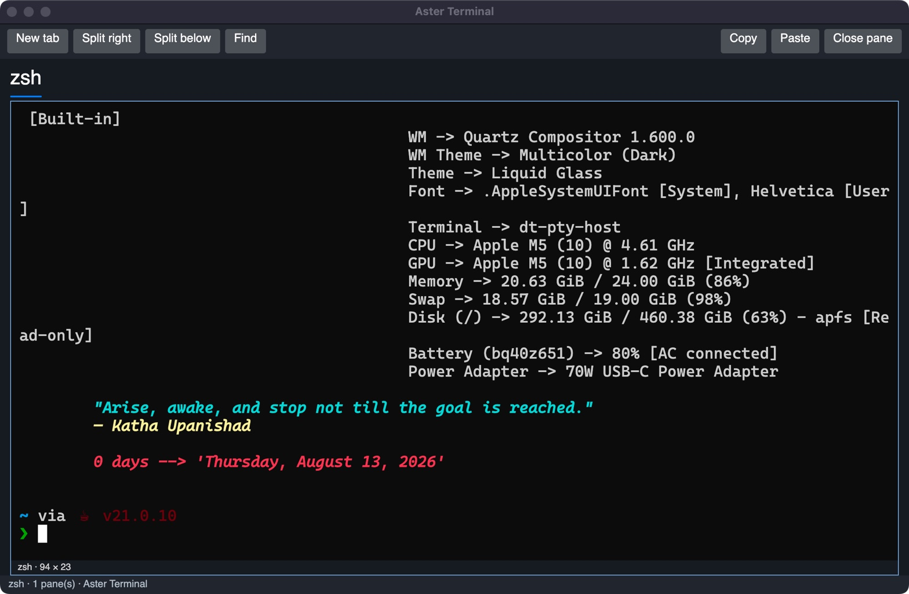

# Aster Terminal

A native C#/Avalonia migration of **iTerm2 behavior**, with a real local shell.
Independent project; no iTerm2 endorsement. GPL-3.0-or-later; see [licensing audit](docs/licensing.md).

**First slice, not competition-ready. Verified on macOS arm64 only.**
Uses .NET 10, Avalonia 12 and the MIT Devolutions embeddable terminal control;
it does not reuse that application's Windows Terminal UI or settings workflow.

## Run and test

Install .NET SDK **10.0.402**. macOS needs Command Line Tools/cc; Linux needs
cc and libutil development headers. The pinned Unix helper builds automatically.
On this workstation an isolated SDK is already in `.research/dotnet`.

```sh
dotnet build Aster.slnx
dotnet test Aster.slnx
dotnet run --project src/App
```

Use `.research/dotnet/dotnet` instead of `dotnet` if the system resolves to .NET 9.
For the isolated SDK on this workstation:

```sh
DOTNET_ROOT="$PWD/.research/dotnet" .research/dotnet/dotnet run --project src/App
```

Default shell is `$SHELL` on Unix (zsh fallback on macOS, bash on Linux),
PowerShell on Windows. No saved settings or live restoration yet.

| Action | macOS | Windows/Linux |
|---|---|---|
| New tab | Cmd+T | Ctrl+Shift+T |
| Split right / below | Cmd+D / Cmd+Shift+D | Ctrl+Shift+D / Ctrl+Shift+Alt+D |
| Close pane | Cmd+W | Ctrl+Shift+W |
| Find | Cmd+F | Ctrl+Shift+F |
| Copy / paste | Cmd+C / Cmd+V | Ctrl+Shift+C / Ctrl+Shift+V |
| Next / previous tab | Ctrl+Tab / Ctrl+Shift+Tab | Ctrl+Tab / Ctrl+Shift+Tab |
| Font size | Cmd+plus / Cmd+minus | Ctrl+Shift+plus / Ctrl+Shift+minus |
| Interrupt process | Ctrl+C | Ctrl+C |

Find uses Enter/Shift+Enter for next/previous, Escape to return to terminal.
Clipboard requests from terminal escape sequences are disabled.

## Migration write-up

Started from an empty repository on 2026-10-14 for the
[Avalonia Port Challenge](https://avaloniaui.net/blog/avalonia-port-challenge).
iTerm2 source is pinned at `069b6e0dd8f3f0d82fc08ea5d294d28f7c5b986e`.
The original joins Objective-C/Swift VT parsing and screen state, AppKit panes,
CoreText/Metal drawing and forkpty-backed process servers. The Avalonia version
rewrites the desktop/session boundaries and reuses a portable terminal component.
We adapted iTerm2's OSC133 positional exit-code scan and OSC1337 cwd/host metadata;
these have regression tests, including fragmented byte streams and semantic attributes.

The first practical obstacle was the reusable package omitting its Unix PTY host.
We imported its pinned MIT C helper and wired host compilation and publish copying.
A second integration obstacle was Avalonia 12's Headless test dependency on xUnit v3.
Both repairs and an incorrect test assumption about nonzero exit state are documented.

Current evidence: **19 passing tests, 1 Windows-only test skipped** on macOS;
real tty, Unicode, colours, resize, Ctrl-C, exit, independent sessions, vim alternate
screen, and Avalonia input/copy/paste/search/tabs/splits/close with real child processes.
Native windows and shortcut-driven layouts were captured. Physical input/IME and
native clipboard checks remain pending. No measured development hours, AI spending
or comparative benchmarks exist; none are claimed.

Native per-pid key events also executed `pwd` in a split pane and rendered zsh's output.



See [original/port evidence](docs/evidence/README.md), [feature parity](docs/iterm2-feature-parity.md),
[architecture](docs/architecture.md), [migration log](docs/migration-log.md),
[test matrix](docs/test-matrix.md), [report](docs/migration-report.md), and
[challenge checklist](docs/challenge-compliance.md).

Next milestone: Windows/Linux runtime acceptance, native keyboard/IME/clipboard,
configurable profiles and persistence, clean matched screenshots, verified release
packaging with all dependency notices, a public repository and submission. Advanced
tmux control mode, reconnecting live sessions, scripting, replay and triggers are
long-term parity work. Local `artifacts/osx-arm64` is a framework-dependent developer
publish, requires .NET 10 and is not a public downloadable release.
The final current developer payload is `artifacts/osx-arm64-final`.
