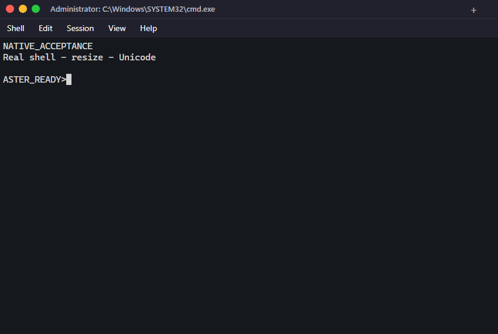
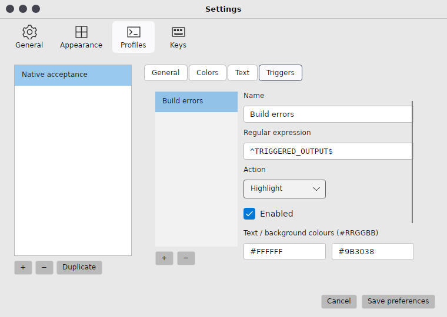
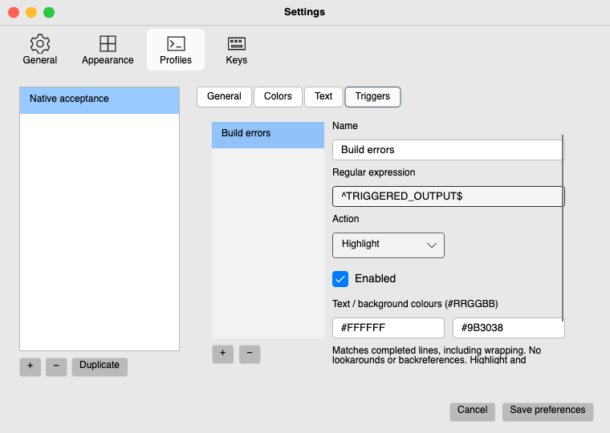

# iTerm2 visual alignment — installed reference 3.7.4

The current target is the user's installed `/Applications/iTerm.app`: its bundle
name is **iTerm2**, version **3.7.4**. The user supplied screenshots and authorised
read-only inspection. Curated measurements are in
[evidence/installed-reference-v0.12.0/reference.json](evidence/installed-reference-v0.12.0/reference.json).
Private shell screenshots remain outside the repository. The previous 3.6.6
reference and 0.11.0 acceptance are historical evidence below.

| Measured difference | 0.12.0 change / acceptance |
|---|---|
| Single terminal has no insertion button; title starts beside window controls | Hide the single-tab plus, retain insertion in the tab strip. Caption inset matches 16/39/62-point button centres; 32-point row. |
| Faint window-number shortcut at the right | Real Option+Command+digit navigation on Mac; Alt+digit on Windows/Linux. Open/close renumbers hints; real-shell desktop regression covers activation and identity. |
| Visible slim scrollbar | Native Avalonia scrollbar over actual retained history; thumb/page controls, wheel sync, bottom-follow, alternate-screen disabling and disposal. Real-shell regression drags the thumb and verifies offset/session identity. Each tmux pane reserves the gutter in its grid budget. |
| Monaco 12 vs old saved Cascadia Mono 14; renderer also enlarged point sizes | Nominal profile size now maps to Cocoa-style logical points. A 12-point setting becomes renderer 9 before its 96/72 conversion. Stored nominal values/fonts remain; existing rendering shrinks by 3/4. Transactional Profiles → Text reference preset selects Monaco 12 on Mac, bundled Cascadia Mono elsewhere, default cursor/theme colours; shell command/environment are retained. |
| Default palette | Installed profile’s 16 ANSI colours, #DCDCDC text, #FFFFFF cursor and #B3D7FF selection replace the dependency default. Explicit foreground/background overrides and RGB escape colours remain effective. |
| Current capture colours | Header #21212F, terminal #15191E; track #22262B and thumb #919395. These supersede the older screenshot's samples. |
| 587×462 logical reference window | Main window minimum reduced to 400×240; native acceptance captures the reference geometry. Existing saved window geometry is retained. |

Native Windows/Linux/macOS and final installed archive verification:
FINAL_REFERENCE_ACCEPTANCE_PENDING

The shell's fastfetch, prompt, output colours and startup scripts belong to the
shell; they are not recreated as UI text. Equal geometry, font settings and tab
count are required for a useful comparison. Monaco is not bundled on Windows or
Linux. OS font rasterization, shadows, corners, compositing, unimplemented
settings pages and physical interaction gaps remain. Matching selected colour
and spacing measurements does not establish complete pixel identity.

# Historical 0.11.0 visual alignment

Target: the attributed iTerm2 3.6.6 dark reference in
[evidence/iterm2-original.png](evidence/iterm2-original.png), supplemented by
pinned source 069b6e0 (PSMMinimalTabStyle.m, PSMTahoeTabStyle.swift and
PreferencePanel.xib) and [official Appearance documentation](https://iterm2.com/documentation-preferences-appearance.html).
The capture and source versions differ. This is a source-referenced native
Avalonia adaptation; no pixel-identical/full UI parity assertion is made.

| Surface | Implementation / final evidence |
|---|---|
| Compact caption | Shared 32-point header, genuine close/minimize/maximize actions; border-only native frame retains resize. Caption drag/double-click use Window APIs. Local desktop action tests pass; physical OS drag/snap remains manual coverage. |
| Dark colours | Sampled reference header #21212D, terminal #15181D and inactive controls #444450. Applied to shared chrome and default terminal scheme; explicit user profile colours remain effective. No terminal font or user shell configuration change. |
| Tabs | Close before centred text, selected pill, fill available width, overflow scroll and selected-tab reveal; actual new-tab button. Existing reorder/cancel/Find/session tests retained. |
| Settings | General/Appearance/Profiles/Keys icon toolbar; profile sidebar and General/Colors/Text/Triggers segments; compact fields. Only functional categories are shown. Transactional save/cancel unchanged. |
| Other windows | Shared caption for tmux, replay, prompts and triggered-line history. Compact Find controls. tmux recalculates its kernel grid from the selected content's size, including Find height. |
| Platform differences | Window-manager shadows/corners, OS text rasterization, available fonts, taskbar/Dock and system menu behavior vary. Proprietary macOS fonts/compositor effects are not bundled or simulated. |
| Wider iTerm2 settings | Unimplemented functionality and its settings pages remain absent, per the feature matrix. This pass cannot establish full upstream UI parity. |

Local headless screenshots in ignored artifacts/ui-design-candidate show the
rendered controls, not native window-manager decorations. New tests exercise
caption actions with real independent shells, three-tab fill at 620 width,
crowded-tab scrolling, minimum-size Settings navigation and focus, plus cleanup.
Final UI source **e283c832610ba307e9861310dee86c3b289f24fe**, run
[39003323494](https://github.com/kris70lesgo/aster-terminal/actions/runs/39003323494):
macOS/Linux **80 passed + 2 Windows-only skips**; Windows **71 passed + 11
Unix-only skips**; **82 total, zero failures** on each target. All three final
native packages pass baseline, global hotkey, crash/reopen and the original
Python client with clean scripting main-loop return. Unix also passes native tmux.

The exact installed Mac archive passes the full ordered verifier at **2× Retina
on macOS 26.7.2**: all eight fixture processes exited, including three unchanged
original Python client runs with matching clean native-loop return. A separate
normal installed launch created an on-screen window; only window metadata was
recorded, with no input or screenshot of the user shell. The first installed
attempt had a Python pre-connection timeout; its parent exited cleanly with code
1. The cause is unconfirmed. The failed attempt and successful instrumented
diagnostic remain in `ui-alignment-investigation-v0.11.0`; the full subsequent
unchanged pass remains in `v0.11.0-macos-retina`.

Native dark/light terminal and Settings captures were inspected on all three
platforms in `evidence/v0.11.0-{rid}`. `ci-v0.11.0.json` pins source/run;
`payload-v0.11.0.json` records all archive checksums, notices, versions, Mac
signatures and installed-byte comparison. Reference colour points and image
hash are in `visual-reference-v0.11.0.json`; this is not a whole-window similarity
score. `ChromeDesktopTests` verifies actual window actions and shell ownership,
tab sizing/overflow and minimum-size Settings focus. Native package acceptance
confirms compact caption structure, tab movement and retained shell state. The
read-only first installed baseline accessibility record is labelled with its
own PID, separate from the final ordered verifier. Physical window drag/snap,
clipboard gestures and the human local Mac hotkey remain unverified.

No upstream image/font/icon asset was imported. Toolbar and caption icons are
small original vector paths. Existing GPL/MIT notices and corresponding source
obligations continue to apply; no new dependency was added.
